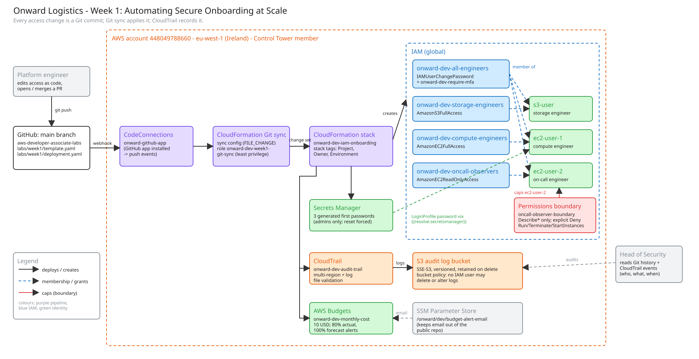

# Week 1: Automating Secure Onboarding at Scale

**Module:** Security & Identity Management on AWS · **Client:** Onward Logistics · **Region:** eu-west-1

Onward onboards 5 to 10 engineers a month, and each one's AWS access is currently set up by hand in the console. This lab replaces that with one CloudFormation template in Git, deployed by Git sync. Every engineer gets the same least-privilege access each time, every change is traceable to a person and a time, and the on-call engineer can never create or terminate compute.

- Discovery report: [Discovery Report - Automating Secure Onboarding at Scale.docx](<Discovery Report - Automating Secure Onboarding at Scale.docx>)
- Template: [template.yaml](template.yaml) · Deployment file: [deployment.yaml](deployment.yaml) · Git sync wiring: [git-sync.yaml](git-sync.yaml)

## How access is controlled



**Groups give each role its day-one access** through AWS managed policies. **The on-call engineer also has a permissions boundary**, so their effective permissions are their group policies AND the boundary. However many policies are attached to `ec2-user-2` or their group later, the boundary is the ceiling.

## Design decisions

| Decision | Reason (in client terms) |
| --- | --- |
| AWS managed policies on **groups**, not policies written per user | The brief asks not to recreate entity-specific policies. Access belongs to the role, so the tenth hire is set up exactly like the first. |
| A **permissions boundary on `ec2-user-2`** | The client's one hard guarantee is that the on-call engineer can never create or terminate compute, "not even if someone later loosens their group's permissions". A boundary is the AWS mechanism that caps a user regardless of what is attached later. Boundaries attach to users or roles, not groups. |
| The on-call boundary allows `Describe*` only, plus an **explicit Deny** on launch and terminate actions | An explicit Deny always wins and documents the intent. `ec2:Get*` is left out on purpose, because it includes `GetPasswordData`, which retrieves Windows administrator passwords. |
| The audit **bucket policy denies every IAM user** from deleting, overwriting or loosening the logs | `AmazonS3FullAccess` would otherwise let the storage engineer delete the evidence of who changed access. A resource policy protects the logs from every user, administrators included, not just one engineer. CloudTrail still writes, and stack changes still flow through the deployment role. |
| **MFA required for every engineer** (`onward-dev-require-mfa` on the all-engineers group) | A stolen password alone is useless: until an engineer signs in with MFA, everything is denied except changing their first password and enrolling their own device. CloudFormation can't enrol a phone for someone, so the template *requires* MFA and each engineer enrols at first sign-in. The on-call boundary allows the self-service MFA actions, so the boundary doesn't lock `ec2-user-2` out. |
| **No inline policies** anywhere | A mandatory requirement. Every permission is a reusable managed policy that auditors can see in one place. |
| **Secrets Manager** generates first passwords, read with a `{{resolve:secretsmanager:…}}` dynamic reference, with `PasswordResetRequired: true` | No plain-text credential exists in Git, chat or the template, and each engineer must replace it with their own password at first sign-in. |
| Secrets and the log bucket have **no fixed names** | Deleted secrets are held for a recovery window and the log bucket is retained, so fixed names would block a rebuild from the repository. |
| A lab-owned **CloudTrail trail** with log file validation, even though Control Tower already runs an organisation trail | The Head of Security can read the evidence in this account. Validation proves the log files weren't altered. |
| The log bucket is **retained** when the stack is deleted, and expires logs after 365 days | Audit logs should outlive the infrastructure they describe, and the expiry keeps storage cost bounded. |
| **Stack tags** in `deployment.yaml` | One place applies `Project`, `Owner` and `Environment` to every taggable resource. |
| The budget email is kept in **SSM Parameter Store** | This repository is public, so the address stays out of Git. |
| Git sync's connection, repository link, role and sync configuration are **also CloudFormation** | Nothing is clicked together. The only console action is the GitHub connection approval, which AWS requires a person to do. |

## Deploy

All commands use the lab profile: `export AWS_PROFILE=onward-logistics`.

**1. Shared GitHub connection (once for all labs, two passes).**

```bash
aws cloudformation deploy \
  --stack-name onward-github-connection \
  --template-file bootstrap/github-connection.yaml \
  --parameter-overrides GitHubOwner=Ghaby-X RepositoryName=aws-developer-associate-labs \
  --tags Project=onward Owner="Gabriel Anyaele" Environment=dev
```

Approve the pending `onward-github` connection in the console: **Developer Tools → Settings → Connections → Update pending connection**. Then link the repository:

```bash
aws cloudformation deploy \
  --stack-name onward-github-connection \
  --template-file bootstrap/github-connection.yaml \
  --parameter-overrides GitHubOwner=Ghaby-X RepositoryName=aws-developer-associate-labs CreateRepositoryLink=true \
  --tags Project=onward Owner="Gabriel Anyaele" Environment=dev
```

**2. Reserve the stack name.** Git sync can only manage a stack that already exists ([AWS docs](https://docs.aws.amazon.com/AWSCloudFormation/latest/UserGuide/git-sync-status.html#git-sync-status-stack-state)). Create an empty placeholder, and Git sync replaces it with the real template on its first sync:

```bash
aws cloudformation deploy \
  --stack-name onward-dev-iam-onboarding \
  --template-file bootstrap/placeholder-stack.yaml \
  --tags Project=onward Owner="Gabriel Anyaele" Environment=dev
```

**3. Week 1 Git sync wiring.**

```bash
aws cloudformation deploy \
  --stack-name onward-dev-week1-git-sync \
  --template-file labs/week1/git-sync.yaml \
  --capabilities CAPABILITY_NAMED_IAM \
  --parameter-overrides BudgetAlertEmail=<your-email> \
  --tags Project=onward Owner="Gabriel Anyaele" Environment=dev
```

Git sync then creates the `onward-dev-iam-onboarding` stack from `labs/week1/deployment.yaml`. From this point, every access change is a commit to `main`.

**4. Hand over first passwords.** An administrator reads each secret (its ARN is in the stack outputs) and passes the password to the engineer over a private channel:

```bash
aws secretsmanager get-secret-value --secret-id <secret-arn> --query SecretString --output text
```

## Evidence

Everything below is in [`evidence/`](evidence/). The simulator results can be regenerated at any time with `evidence/simulate.sh`.

| Client check | Result | Evidence |
| --- | --- | --- |
| Each engineer can do their job on day one | **Met.** `s3-user` created a bucket, `ec2-user-1` launched an instance, and `ec2-user-2` could see the running instance. | [simulator baseline](evidence/01-simulator-baseline.md), `s3-user-2-*`, `ec2-user-1-2-*`, `ec2-user-2-2-*` |
| …and cannot do more | **Met.** Each user was denied outside their role: S3 for the compute users, EC2 and IAM for `s3-user`, IAM for `ec2-user-1`. Nobody could delete the audit logs. | [simulator baseline](evidence/01-simulator-baseline.md), `ec2-user-1-3/4-*`, `ec2-user-2-5-*`, `s3-user-3-*` |
| Secure first login, no shared plain-text credential | **Met.** Passwords are generated by Secrets Manager and readable only by administrators. A reset is forced at first sign-in. | `ec2-user-1-1-forced-password-reset.png` |
| MFA required before any access | **Met.** Without MFA, every role action is explicitly denied. With MFA, each engineer gets exactly their day-one access. Changing the first password and enrolling an MFA device work before MFA, including for `ec2-user-2` under its boundary. | [simulator with MFA](evidence/05-simulator-mfa.md) |
| On-call engineer can't create or terminate compute, even after permissions are added | **Met.** With `AmazonEC2FullAccess` attached to the on-call group (commit `dec18d4`), `ec2-user-2` was still explicitly denied `RunInstances`, `TerminateInstances` and `StartInstances` by the boundary. It was reverted in `241a6d7`. | [simulator with extra permissions](evidence/02-simulator-extra-permissions.md), `extra-1/2/3-*`, `ec2-user-2-3-*` |
| Head of Security can see how access was defined and who changed it | **Met.** Every access change maps to a Git commit (author, time, reason) and to a CloudTrail event performed by the Git sync role. A change made outside Git paused syncing until it was signed off. | [audit trail](evidence/03-audit-trail.md) |
| The whole setup can be rebuilt from the repository | **Demonstrated live in the review.** The original build already came from the repo: Git sync created every resource from an empty placeholder (see the CloudTrail events in the audit trail). Live: delete `onward-dev-iam-onboarding`, recreate the placeholder, and Git sync rebuilds it from `main`. | [audit trail](evidence/03-audit-trail.md), [deploy steps](#deploy) |

## Cleanup

```bash
aws cloudformation delete-stack --stack-name onward-dev-week1-git-sync
aws cloudformation delete-stack --stack-name onward-dev-iam-onboarding
# The audit log bucket is retained by design, and its bucket policy blocks every IAM user
# (including admins) from deleting it. Remove it after grading using an assumed role
# (e.g. your IAM Identity Center admin role) or the account root user.
# Delete onward-github-connection only after the last lab is finished.
```
