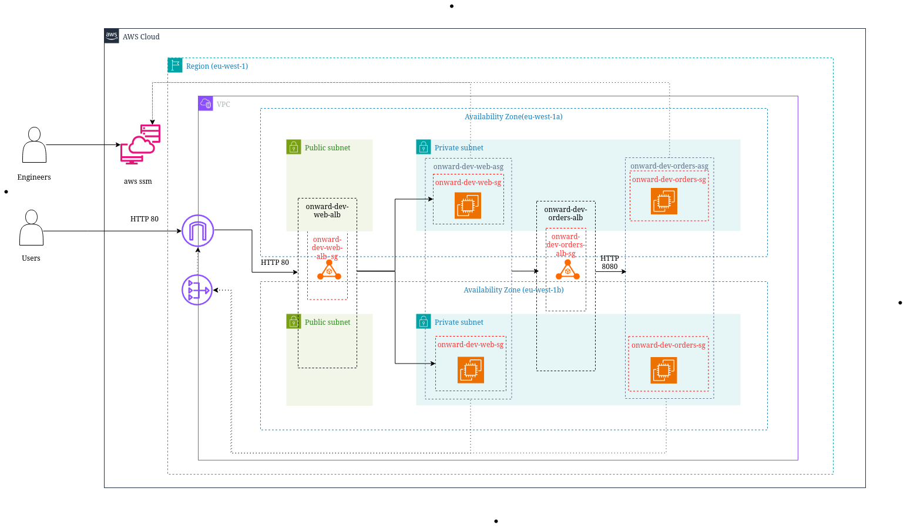

# Week 2: Designing a Secure Network for the Onward Logistics Order System

**Module:** Network & Security on AWS · **Client:** Onward Logistics · **Region:** eu-west-1

Onward's order system runs on one hand-built public server. If that server or its data center fails on a sales day, every order stops, and the order services and the SSH port face the internet. This lab moves it into a layered network in two Availability Zones. The front end keeps working if a zone is lost, nothing internal can be reached from the internet, and engineers administer every server without an open admin port or a shared key.

- Discovery report: [docs/discovery.docx](docs/discovery.docx)
- Template: [template.yaml](template.yaml) · Deployment file: [deployment.yaml](deployment.yaml) · Git sync wiring: [bootstrap/git-sync.yaml](../../bootstrap/git-sync.yaml)

## How the network works



**Every layer only accepts traffic from the layer in front of it:**

| Layer | Name | Where | Accepts |
| --- | --- | --- | --- |
| Internet-facing load balancer | `onward-dev-web-alb` | public subnets, both zones | port 80 from anyone |
| Web servers (2 × t3.micro) | `onward-dev-web-asg` | private subnets, one per zone | port 80 from the web load balancer only |
| Internal load balancer | `onward-dev-orders-alb` | private subnets, both zones | port 8080 from the web servers only |
| Order servers (2 × t3.micro) | `onward-dev-orders-asg` | private subnets, one per zone | port 8080 from the internal load balancer only |

The web servers reach the order services through the internal load balancer's DNS name, written into their Apache config at boot. A request to `/orders/` on the front end is proxied there, so the whole path can be tested from a browser.

**Outbound only:** private servers reach the internet through one **regional NAT gateway** (for package downloads) and reach Systems Manager the same way. Session Manager uses the connection the agent opens *out* to AWS, so no security group opens port 22 and no server has a key pair.

| Subnet | CIDR | Route table |
| --- | --- | --- |
| `onward-dev-public-a` / `-b` | `10.20.0.0/24`, `10.20.1.0/24` | `0.0.0.0/0` → internet gateway |
| `onward-dev-private-a` / `-b` | `10.20.10.0/24`, `10.20.11.0/24` | `0.0.0.0/0` → regional NAT gateway (one shared route table) |

## Design decisions

| Decision | Reason (in client terms) |
| --- | --- |
| **Two Availability Zones**, with a web and an order server in each | The CTO needs the front end up "even if part of the data center has a problem". Losing a zone stops neither the website nor order processing. |
| **Auto Scaling groups** (min 2, max 4) with **load balancer health checks** | A failed server or zone is replaced automatically, and a server only gets traffic once its health check passes. The maximum leaves room for sales days. |
| A **separate internal load balancer** for the order services | It gives the web servers one fixed name for order servers that change when replaced, and it has no public address. A second listener on the public load balancer would put the order services on a public endpoint. |
| All servers in **private subnets**, `MapPublicIpOnLaunch: false` | The Head of Security's rule: nothing internal reachable from the internet. Private subnets have no route in from the internet at all. |
| **Four security groups**, each referencing the one in front of it | The rules follow the layers rather than IP ranges, so a replaced server is covered automatically. No group allows SSH or any admin port. |
| **Regional NAT gateway** (`AvailabilityMode: regional`) | The Head of Operations' servers can download updates without a public address. It has the same zone resilience and price as one NAT gateway per zone, but needs no subnet of its own and only one private route table. |
| **Session Manager** through the AWS managed `AmazonSSMManagedInstanceCore` policy | Engineers get a shell with no inbound port and no keys, and every session is tied to the engineer's own IAM identity. The policy is managed, so there are no inline policies. |
| **IMDSv2 required**, encrypted gp3 volumes, `standard` CPU credits | IMDSv2 blocks the metadata-theft technique used in the Capital One breach. Standard credits mean a t3.micro can never bill above its hourly rate. |
| The page is **installed by UserData at boot**, not baked into an AMI | Every replacement is identical and patched, with no separate image pipeline. The script runs `cfn-signal`, so CloudFormation only reports success once both servers in a tier are serving. |
| **Rolling updates**, one server at a time with at least one in service | A template change replaces servers without taking the front end down. |
| **Stack tags** in `deployment.yaml` and tags on the launch templates | `Project`, `Owner` and `Environment` reach every resource, including instances and volumes, so the Finance Lead can see this stack's spend in Cost Explorer. |

## Cost

On-demand eu-west-1 prices from the AWS Price List (16 October 2026), 730 hours a month:

| Item | Per month |
| --- | --- |
| 2 Application Load Balancers | USD 36.79 + usage |
| Regional NAT gateway, active in 2 zones | USD 70.08 + data |
| 4 public IPv4 addresses (web ALB and NAT gateway, one per zone each) | USD 14.60 |
| 4 × t3.micro | USD 33.29 |
| 4 × 8 GB gp3 | USD 2.82 |
| **Total** | **about USD 158 a month, about USD 0.22 an hour, about USD 5 a day** |

The rejected alternatives (a shared zonal NAT gateway, VPC endpoints, one shared load balancer, a bastion host, a baked AMI) and their savings are in the [discovery report](docs/discovery.docx).

## Deploy

All commands use the lab profile, `--profile onward-logistics`. The shared GitHub connection (`bootstrap/github-connection.yaml`) is already in place from [Week 1](../week1/README.md#deploy).

**1. Reserve the stack name.** Git sync can only manage a stack that already exists, so create an empty placeholder:

```bash
aws cloudformation deploy --profile onward-logistics \
  --stack-name onward-dev-orders-network \
  --template-file bootstrap/placeholder-stack.yaml \
  --tags Project=onward Owner="Gabriel Anyaele" Environment=dev
```

**2. Point Git sync at Week 2.**

```bash
aws cloudformation deploy --profile onward-logistics \
  --stack-name onward-dev-git-sync \
  --template-file bootstrap/git-sync.yaml \
  --capabilities CAPABILITY_NAMED_IAM \
  --parameter-overrides Lab=week2 StackPurpose=orders-network \
  --tags Project=onward Owner="Gabriel Anyaele" Environment=dev
```

Git sync then replaces the placeholder with `labs/week2/template.yaml`, using the parameters and tags in `labs/week2/deployment.yaml`. The build takes about 10 minutes, mostly waiting for all four servers to signal. From then on, every change to the network is a commit to `main`.

**3. Get the front-end address.**

```bash
aws cloudformation describe-stacks --profile onward-logistics \
  --stack-name onward-dev-orders-network \
  --query 'Stacks[0].Outputs' --output table
```

`WebUrl` shows the front end, and `OrdersUrlFromWebTier` shows an order server's reply, reached through the internal load balancer.

## Demonstrating the client's checks

Run these live in the review. Set up the shell first:

```bash
export AWS_PROFILE=onward-logistics AWS_REGION=eu-west-1
WEB_URL=$(aws cloudformation describe-stacks --stack-name onward-dev-orders-network \
  --query "Stacks[0].Outputs[?OutputKey=='WebUrl'].OutputValue" --output text)
```

**1. The front end can be reached from the internet, from both zones.** Each reply shows the instance ID and zone of the server that answered:

```bash
while true; do curl -s "$WEB_URL" | grep -oE 'i-[0-9a-f]+|eu-west-1[a-c]' | paste -sd' '; sleep 1; done
```

`curl -s "$WEB_URL/orders/"` shows an order server answering through the internal load balancer.

**2. No one on the internet can start a connection to an internal server.**

```bash
# No server has a public IP or a key pair
aws ec2 describe-instances \
  --filters Name=tag:aws:cloudformation:stack-name,Values=onward-dev-orders-network Name=instance-state-name,Values=running \
  --query 'Reservations[].Instances[].[Tags[?Key==`Name`]|[0].Value,PrivateIpAddress,PublicIpAddress,KeyName]' --output table

# No security group allows SSH, and each tier only accepts the layer in front of it
aws ec2 describe-security-groups --filters Name=group-name,Values='onward-dev-*' \
  --query 'SecurityGroups[].[GroupName,IpPermissions[].[FromPort,IpRanges[].CidrIp|join(`,`,@),UserIdGroupPairs[].GroupId|join(`,`,@)]]' --output json

# The internal load balancer resolves only to private 10.20.x.x addresses
dig +short $(aws elbv2 describe-load-balancers --names onward-dev-orders-alb --query 'LoadBalancers[0].DNSName' --output text)
```

**3 and 4. Engineers administer each server without open ports, and internal servers can download packages.** Start a session on each server in turn:

```bash
aws ec2 describe-instances --filters Name=tag:Name,Values=onward-dev-orders Name=instance-state-name,Values=running \
  --query 'Reservations[].Instances[].[InstanceId,Placement.AvailabilityZone]' --output text
aws ssm start-session --target <instance-id>
```

Inside the session:

```bash
sudo dnf install -y tree   # downloads through the NAT gateway
whoami; curl -s -m 5 https://checkip.amazonaws.com   # outbound works, and shows the NAT gateway's address
```

Session history (Systems Manager → Session Manager → Session history) shows which IAM identity connected and when.

**5. What happens if a zone or server is lost.** Keep the loop from check 1 running in another terminal, then terminate the web server in one zone:

```bash
aws ec2 terminate-instances --instance-ids $(aws ec2 describe-instances \
  --filters Name=tag:Name,Values=onward-dev-web Name=availability-zone,Values=eu-west-1a Name=instance-state-name,Values=running \
  --query 'Reservations[0].Instances[0].InstanceId' --output text)
```

The loop keeps answering from eu-west-1b. The load balancer stops routing to the terminated server, and Auto Scaling launches a replacement in eu-west-1a, which rejoins the loop after its health check passes (about 3 to 5 minutes). Watch it with:

```bash
aws autoscaling describe-scaling-activities --auto-scaling-group-name onward-dev-web-asg --max-items 3 \
  --query 'Activities[].[StartTime,StatusCode,Description]' --output table
```

The same works for the order tier (`onward-dev-orders`, `$WEB_URL/orders/`). If a whole zone is lost, the load balancers, the NAT gateway and both tiers keep running in the other zone.

**6. What it costs, and the alternatives rejected.** See [Cost](#cost) and the [discovery report](docs/discovery.docx).

**7. The whole setup can be rebuilt from the repository.** Delete the stack, recreate the placeholder ([Deploy step 1](#deploy)), and Git sync rebuilds it from `main`. If no sync starts within a few minutes, push a commit that touches `labs/week2/deployment.yaml` or `template.yaml` to trigger one. The rebuild takes about 10 minutes.

## Cleanup

The stack costs about USD 0.22 an hour while it runs. Delete it once the lab is graded:

```bash
aws cloudformation delete-stack --profile onward-logistics --stack-name onward-dev-orders-network
# Leave onward-dev-git-sync in place and redeploy it with the next lab's Lab and StackPurpose.
```
